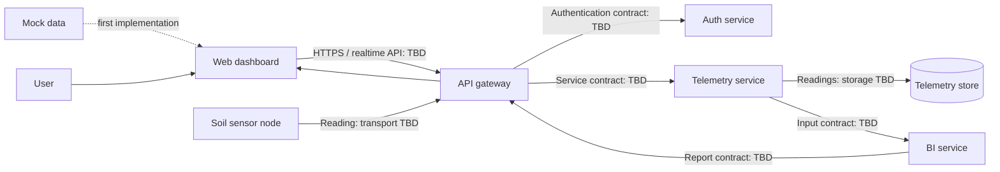

# Architecture Overview

This document describes the intended system boundaries for Smart Farmland. It is a design starting point, not a description of running software. Specific infrastructure, data stores, device transport, authentication mechanisms, and service APIs remain undecided.

## Components

- **Soil node firmware (`firmware/node-soil/`)** collects measurements and sends them to the platform. Provisioning, transport, and offline buffering need to be selected.
- **Web app (`apps/web/`)** provides the user interface for farm, device, reading, and report workflows.
- **API gateway (`apps/gateway/`)** is the client-facing boundary. The scaffold anticipates REST, Socket.IO, and gRPC clients; the exact division of responsibilities is still to be defined.
- **Auth service (`apps/auth-service/`)** owns user authentication and the associated identity/session interface. Its credential, token/session, and authorization design is still to be selected. Device authentication may use a separate mechanism.
- **Telemetry service (`apps/telemetry-service/`)** owns ingestion, validation, storage, and retrieval of raw sensor readings.
- **BI service (`apps/bi-service/`)** owns derived analytics and report generation. Its inputs and output formats should be specified with the first report requirements.
- **Protocol contracts (`proto/`)** define versioned service-to-service messages and RPCs. Generated code belongs in `packages/proto-gen/` and should not be edited by hand.
- **Shared packages (`packages/`)** contain code that is genuinely reused across projects, such as common DTOs, constants, and configuration.

## Proposed Data Flow

The intended delivery order is mock-data dashboard, auth service, device ingestion through gateway to telemetry, BI, and then full integration. The diagram is conceptual: it does not prescribe a database, deployment topology, or final network protocol. The dashed mock-data edge represents the initial dashboard phase, not a production dependency.

## Ownership and Boundaries

- The telemetry service is the source of truth for raw readings; analytics should not silently rewrite them.
- The auth service owns user identity/authentication behavior; the gateway enforces the agreed access policy at client-facing boundaries.
- The gateway adapts client requests to backend interfaces and should not become the owner of telemetry or analytics data.
- Device credentials and user credentials should have clearly separated ownership and lifecycle unless a deliberate design decision establishes otherwise.
- Service contracts should be versioned and changed compatibly where practical. Breaking changes need an explicit migration plan.
- Shared packages should remain small; domain behavior should stay with the service that owns it.

## Cross-Cutting Concerns to Decide

- Auth-service identity, credential storage, session/token lifecycle, authorization, and farm-level access control.
- Device enrollment, device credentials, provisioning, and credential rotation.
- Device transport, retry behavior, duplicate detection, clock drift, and offline buffering.
- Storage technology, indexes, retention, backups, and data export.
- Realtime update requirements and whether Socket.IO is needed for the first release.
- Deployment environment, secrets management, observability, and service availability targets.

Record consequential decisions in `docs/adr/` so implementation choices have context.
